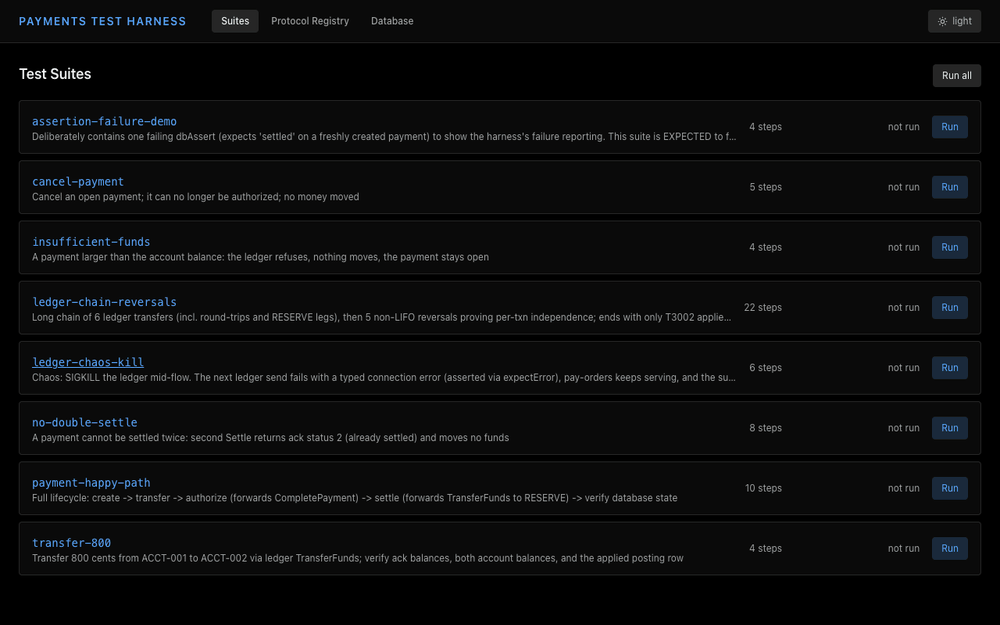

# payments-test-harness

A payments backend in C (three TCP processes, function-pointer message
tables, SQLite) plus a test-harness app in Electron/React/TypeScript that
runs persisted JSON test suites in realtime — and an **MCP server** that lets
an AI agent author those tests itself, grounded in a generated **knowledge
base** of per-directory "intern guides".

It is a self-contained sample of a real engineering pattern: *one source of
truth for the wire protocol, generated from the C code, consumed by every
layer* — and a knowledge pipeline that turns "the code says what fields
exist" into "the agent knows what the code does".

**~51-second demo** (half speed) — the suites list; a live `pi` session running a local
27B model (llama.cpp `qwen3`) that authors a double-settle test through the
harness MCP tools and runs it 10/10 green; back in the app, *that* suite has
appeared in the list and runs green; then `ledger-chaos-kill` with the
`ECONNRESET` failure expanded → Protocol Registry → verified balances in the
per-suite database:



## Architecture

```
┌──────────────────────────── BACKEND (C11, 3 processes) ────────────────────────────┐
│                                                                                    │
│  pay-orders :9101        ledger :9102            auth-gateway :9103                 │
│  (payment lifecycle)     (double-entry)          (external auth/settle boundary)    │
│      │                         ▲                     │        │                     │
│      └── CompletePayment ──────┼─────────────────────┘   TransferFunds (settle)     │
│                                └───────────────────────────────────────────┐        │
│        ┌───────────────────────────────────────────────────────────────────▼──┐    │
│        │ shared: envelope codec · TCP server + function-pointer dispatch table │    │
│        │ SQLite (accounts, payments, ledger_entries, ledger_txns)              │    │
│        └───────────────────────────────────────────────────────────────────────┘    │
└──────────────────────────────────────────────────────────────────────────────────────┘
        ▲ wire protocol (8-byte LE header + packed payload)
┌───────┴──────────────────────────────────────────────────────────────────────────────┐
│ HARNESS (Electron + React + TS)                                                      │
│  main:  backend cluster · registry (from --introspect) · runner (Node module,        │
│         electron-free) · suite CRUD · read-only db · MCP server (stdio, 15 tools)    │
│  renderer:  /suites  live run + step results + backend log                           │
│             /registry  the introspected wire protocol                                │
│             /database  read-only SQL over per-suite databases                        │
└──────────────────────────────────────────────────────────────────────────────────────┘
┌──────────────────────────── KNOWLEDGE LAYER (kb-forge) ─────────────────────────────┐
│  knowledge/*.md intern guides (one per source dir): messages + side effects, risks, │
│  inter-process interactions, domain vocabulary — generated, then committed          │
│  consumers:  MCP test author (kb_search/kb_read/schema notes) · designer CLI        │
└──────────────────────────────────────────────────────────────────────────────────────┘
```

**The core trick.** Each C message is declared once as an X-macro field list
(`backend/include/pay/messages.h`) that expands into the packed struct *and*
the metadata table (name, type, `offsetof`). Each process's dispatch table is a
function-pointer array (`msg_id → handler`). A `--introspect` mode prints that
table as JSON; `npm run gen:registry` merges the three outputs into
`harness/src/protocol/registry.json`. The codec, the GUI, the suite validator,
and the MCP schemas all derive from that one file.

**The second trick.** kb-forge walks the code and writes per-directory guides
(what each message *does*, not just its shape). An agent that reads them
asserts real side effects — e.g. that an `Authorize` drives the payment to
`complete` via the gateway's forward — while a schema-only agent stops at the
local ack.

## Quickstart (macOS, Apple clang — tested)

```bash
# 1. Build the backend (C11, -Wall -Wextra -Werror -O2)
make -C backend

# 2. Harness deps + generated registry (runs the C binaries with --introspect)
cd harness
npm install
npm run gen:registry

# 3. Verify everything — one command:
npm run verify                  # backend build + ASan/UBSan smoke (28 checks) + fmt
                                # + typecheck + unit tests + happy-path suite
                                # + MCP self-test (KB on/off A/B)
                                # + recorded-trace replay + KB staleness check

# 4. The app
npm start                       # Electron: suites / registry / database
HARNESS_SELF_TEST=1 npm start   # headless e2e self-test (drives the real UI)
```

> **npm note (this machine's policy):** install scripts are blocked by
> default; approve them once with
> `npm install-scripts approve better-sqlite3 esbuild fsevents electron`.
> (The committed harness uses Node's built-in `node:sqlite`, so only the
> dev/build tooling needs approving.)

## CI

GitHub Actions (`.github/workflows/verify.yml`) runs two jobs on every push/PR
to `main`:

| Job | What it runs |
|---|---|
| `verify` | the *exact* one-command check developers run locally (`npm run verify`): C build with `-Werror`, ASan/UBSan build + 28-check protocol smoke, `clang-format --dry-run` (pinned to 23.1.3 — formatting is version-sensitive), typecheck, `node:test` unit tests (codec round-trip, ack matching, KB search, suite validation, hostile-suite cases, read-only db), live happy-path suite against a fresh cluster, MCP author A/B (KB on vs `MCP_NO_KB=1`), recorded-trace replay of the agent surface (no LLM), KB staleness check. Run reports are uploaded as an artifact. |
| `e2e` | builds the app, loads the real Electron window under Xvfb, then drives the renderer through the actual preload bridge: `listSuites` + `runSuite('payment-happy-path')`. Non-zero exit on any failure. |
| `eval` (opt-in) | real-model eval against a live endpoint: full 11-task run with the committed per-model baseline gate. Off unless the `EVAL_RUN_EVAL` repository variable is `true` and `EVAL_API_*` secrets exist (`.github/workflows/eval.yml`) — on a schedule, on demand, and on pushes touching the agent surface. |

The harness itself is unit-tested with the built-in `node:test` runner
(`npm run test:unit`, 23 tests, no test framework added): the codec
round-trips every message in the registry, `matchAck` pin semantics, KB
search finds the row the eval depends on, `validateSuite` rejects the
hostile-suite cases (unknown messages, path-traversal names, non-SELECT
dbAssert), and the read-only db handle refuses DDL.

## Benchmark

`npm run bench` starts a fresh backend cluster, sends sequential
`TransferFunds` (one in flight) from a single client, and reports throughput
plus ack-latency percentiles. Each op is a full round trip: framed request
out, C handler executes (SQLite read → validate → commit), framed ack back.
500 measured ops after 50 warmup, three runs on the author's laptop
(Apple Silicon, macOS):

| ops | throughput | p50 | p95 | p99 | max |
|---|---|---|---|---|---|
| 500 | 8,233/s | 99 μs | 165 μs | 271 μs | 2.59 ms |
| 500 | 8,677/s | 90 μs | 161 μs | 350 μs | 2.70 ms |
| 500 | 8,445/s | 96 μs | 150 μs | 389 μs | 2.65 ms |

Read this as "protocol + single-threaded SQLite commit cost over loopback
on one machine", not a scaling claim: each run is one client against a fresh
three-process cluster.

## Evaluation — does the knowledge base actually make a difference?

The GIF is one unedited session; the eval is the controlled experiment
behind it. `harness/src/eval/` runs a model-agnostic agent (OpenAI-
compatible chat endpoint + the same 15 MCP tools an external client would
use) through 11 plain-English tasks, twice per task — **KB on** (15 tools,
`kb_search`/`kb_read` live) vs **KB off** (`MCP_NO_KB=1`, 13 tools) — and
scores the artifact, not the agent's word: the generated suite is re-run on
a fresh cluster and checked against an exact ground-truth checklist
(balance math from the seed data, ack status codes, side-effect rows). No
LLM judge. `pass` = suite created + green re-run + full checklist.

```bash
npm run eval:smoke            # 3 tasks x 1 run x both variants
npm run eval                  # 11 tasks x 3 runs x both variants
```

Committed result — **Qwen3.8-27B Q4_K_M** (the GIF's model, via llama.cpp),
3 runs per task, temperature 0, full-fidelity traces in
[`harness/eval-reports/sample-qwen3-27b.json`](harness/eval-reports/sample-qwen3-27b.json):

| config | pass | suite green | checklist full | avg tool calls | avg suite runs | p50 wall (s) |
|---|---|---|---|---|---|---|
| **kb-on** | **33/33** | 33/33 | 33/33 | 13.2 | **1.0** | 13 |
| **kb-off** | 32/33 | 32/33 | 32/33 | 14.6 | 1.3 | 11 |

What the numbers say, honestly: a strong local model plus the self-correcting
loop (red suite → inspect → `update_suite` → re-run) can converge even
schema-only — so on a 27B the KB's value shows as **efficiency**, not as
pass-or-fail: KB-on suites were one-shot (avg 1.0 re-runs) vs 1.3 KB-off,
and the single failure (KB-off, `unknown-account`, 2/3) is exactly the class
of miss the KB exists to prevent. Expect the gap to widen toward pass rate
on weaker models. Two tasks are KB-sensitive by construction — their
ground truth lives only in the intern guides (e.g. *where* settlement money
moves), and the prompts never leak it. Methodology, task set, and how to
add tasks: [`docs/eval.md`](docs/eval.md).

The eval is also a regression gate in two layers. **Layer A** is
deterministic: `npm run eval:replay` (in `npm run verify`, ~4 s, no LLM)
replays recorded agent tool-call traces against the live MCP server and
asserts properties of each result — catching tool renames, KB content
regressions (the KB on/off `notes` pin), and error-message wording changes
on every push. **Layer B** is a real-model job (`.github/workflows/eval.yml`)
that runs the full eval and fails on regression below the per-model baseline
committed in `harness/src/eval/baseline.json`; it is opt-in via the
`EVAL_RUN_EVAL` repository variable + `EVAL_API_*` secrets.

## The wire protocol

Little-endian frame: `u16 magic (0x5046) | u16 msg_id | u32 payload_len |
payload[]`; payloads are packed structs at the exact `offsetof` offsets.

| process | port | in messages | out messages |
|---|---|---|---|
| pay-orders | 9101 | CreatePayment (10) · CancelPayment (11) · CompletePayment (12) | PaymentAck (20) |
| ledger | 9102 | TransferFunds (30) · ReverseTransfer (31) | TransferAck (32) |
| auth-gateway | 9103 | Authorize (40) · Settle (41) | AuthResponse (42) · SettleAck (43) |
| all | — | — | ErrorAck (255) |

Full field tables, offsets, and ack status codes: [`docs/protocol.md`](docs/protocol.md).

## Test suites

Suites are plain JSON in `harness/suites/` — four step kinds, registry-
validated, each run against a **fresh backend cluster + fresh database**
(`harness/data/<suite>.db`, kept for inspection). `no-double-settle` was
not hand-written: a local LLM authored it through the MCP server (the GIF
above is that session, unedited):

```json
{
  "id": "create",
  "send": { "to": "pay-orders", "msg": "CreatePayment",
            "fields": { "txn_id": 2001, "account": "ACCT-001",
                        "amount_cents": 50000, "currency": "USD" } },
  "expectAck": { "status": 0 }
}
```

(10 steps total: create → authorize → complete → settle → settle again
(rejected), with `dbAssert`s proving the balances.)

- `send` — encode via the registry codec, wait for the matching ack;
  `expectAck` is a **partial match** on fields; `expectError: true` inverts
  the check (the step passes when the send fails — failure-mode tests).
- `dbAssert` — one-row `SELECT` + partial match on columns (reads the same
  SQLite file the C processes write).
- `delayMs` — pacing across fire-and-forget inter-process forwards.
- `killProcess` — chaos: SIGKILL/SIGTERM a backend process mid-run.

Seven suites are committed: `payment-happy-path` (10/10 green),
`ledger-chain-reversals` (22 steps), `insufficient-funds`, `cancel-payment`,
`transfer-800`, `ledger-chaos-kill` (kills the ledger mid-run, asserts the
typed failure with `expectError`, verifies state is exactly pre-kill), and
`assertion-failure-demo` (demonstrates a failing run with an
expected-vs-actual diff).

```bash
npm run run:cli -- suites/insufficient-funds.json
```

Every run — from the app, the CLI, or the MCP server — also writes a
self-contained **HTML report** to `docs/test-runs/<suite>_<timestamp>.html`
(styled like the app: dark by default, paper beige under
`prefers-color-scheme: light`). It shows each step's action, the
pass/fail status, and the assertions with expected vs actual values —
failing rows and mismatched fields highlighted in red.

## Knowledge pipeline

```bash
npm run kb                       # regenerate knowledge/ guides (deterministic)
npm run kb -- --llm              # …with LLM-enhanced prose (KB_API_KEY)
npm run kb:check                 # merge gate: stale guide = bug
npm run kb:search -- "authorization completes payment downstream"
npm run design -- "add a refund message that reverses a settled payment"
MCP_NO_KB=1 npm run design -- "…"   # A/B: schema-only design for contrast
```

kb-forge writes one **intern guide** per source directory (fixed section
schema: Purpose / Files / Domain vocabulary / Messages with preconditions and
side effects / Key functions with `file:line` / Common modification points /
Risks / Inter-process interactions). Consumers:

- **MCP test author** — `kb_search`/`kb_read` tools; `get_message_schema`
  carries the KB row as `notes`; `create_suite` failures carry `kbHints`.
  `MCP_NO_KB=1` disables it all (the A/B switch the [eval](#evaluation--does-the-knowledge-base-actually-make-a-difference)
  uses to measure the difference). → [`docs/mcp.md`](docs/mcp.md)
- **Designer** — turns a plain-English change request into a reviewable
  design doc (X-macro proposal, handler sketch, risks citing `knowledge/`
  paths, suggested suite). Sample outputs: [`docs/designs/`](docs/designs/).

→ [`docs/knowledge.md`](docs/knowledge.md)

## The 6-minute demo

(Quick version: the half-speed GIF at the top of this file — step 5 is the
part it plays live.)


1. **0:00 Build & introspect.** `make -C backend && npm run gen:registry` —
   "the registry is generated from the C function-pointer tables, not
   written."
2. **0:45 Protocol Registry tab.** Three processes live; open the tab: every
   message, field, type, size, and packed offset — all of it introspected.
3. **1:45 Happy path.** Run `payment-happy-path` in the app → live step
   timeline, 10/10 green, DB balances validated (400000 / 300000 /
   1050000 cents), forwards visible in the log feed.
4. **3:00 Failure demo.** Run `assertion-failure-demo` → a step fails with an
   expected-vs-actual diff; the run continues and reports the failure.
5. **4:00 Agent-authored test.** In any MCP client: *"make a test that
   verifies an external authorization completes a payment"* → the agent calls
   `kb_search`, reads `knowledge/backend/auth_gateway.md`
   ("on approve → forwards `CompletePayment`"), and the generated suite
   contains the downstream `dbAssert` a schema-only agent misses →
   `run_suite` green, suite visible in the app.
6. **5:15 Designer.** `npm run design -- "add a refund message that reverses a
   settled payment"` → design doc with X-macro list, handler sketch, and risks
   citing `knowledge/backend/ledger.md`.

## Repo map

```
backend/
  include/pay/        envelope, X-macro message defs, dispatch table, db, socket
  src/common/         codec, TCP server + dispatch, introspection, sqlite, log
  src/pay_orders/     payment lifecycle (:9101)
  src/ledger/         double-entry ledger (:9102)
  src/auth_gateway/   auth/settle boundary (:9103) + forwarding
  db/schema.sql       accounts, payments, ledger_entries, ledger_txns (+seed)
  tools/smoke_test.py 28-check protocol test (part of `make check`)
harness/
  src/protocol/       registry.json (generated) + codec + framed TCP client
  src/runner/         the suite engine (electron-free) + headless CLI
  src/backend/        cluster lifecycle, suite CRUD, path helpers
  src/main/           Electron main + preload bridge (+ self-test mode)
  src/renderer/       React UI (sandboxed) — suites / registry / database
  src/mcp/            MCP server (15 tools) + KB tools
  src/kb/             kb-forge generator + deterministic retrieval
  src/design/         the designer CLI
  src/eval/           the KB on/off evaluation harness (npm run eval)
                      + recorded-trace replay gate (npm run eval:replay)
  eval-reports/       eval reports (sample-qwen3-27b.* committed; rest gitignored)
  src/**/*.test.ts    node:test unit tests (npm run test:unit)
  suites/             8 committed sample suites (no-double-settle is agent-authored)
  scripts/            gen_registry.js · mcp-self-test.js · demo-gif/ (GIF capture pipeline)
knowledge/            generated intern guides (+ INDEX.md + .manifest.json)
docs/
  plans/InitialDesign.md    the full design plan (phases P1–P6)
  conventions/conventions.md the project's conventions & gates
  protocol.md · mcp.md · knowledge.md
  designs/          sample designer output (KB-grounded vs schema-only pair)
  demo.gif          the ~51s half-speed demo (linked at the top of the
                    README; regenerate with the harness/scripts/demo-gif/
                    pipeline)
```

## Design notes

- **Partial-match assertions.** Suites pin only the fields that matter, so a
  new ack field doesn't break every suite — pin it explicitly when it does.
- **The runner is electron-free.** Plain Node: the same engine drives the
  headless CLI, the app, and the MCP server.
- **X-macros over codegen.** The C is the generator: struct, metadata, and
  dispatch all come from one field list; `--introspect` is a print, not a
  pipeline.
- **Generated artifacts are committed.** Registry, guides, and a sample
  design are in the repo — the project is demoable offline, with no API keys.
- **Localhost only.** Everything binds 127.0.0.1; there is no network surface
  beyond 9101–9103 on loopback.

Conventions, gates, and commit policy: [`docs/conventions/conventions.md`](docs/conventions/conventions.md).

## License

MIT — see [LICENSE](LICENSE).
